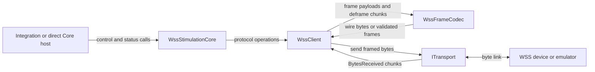
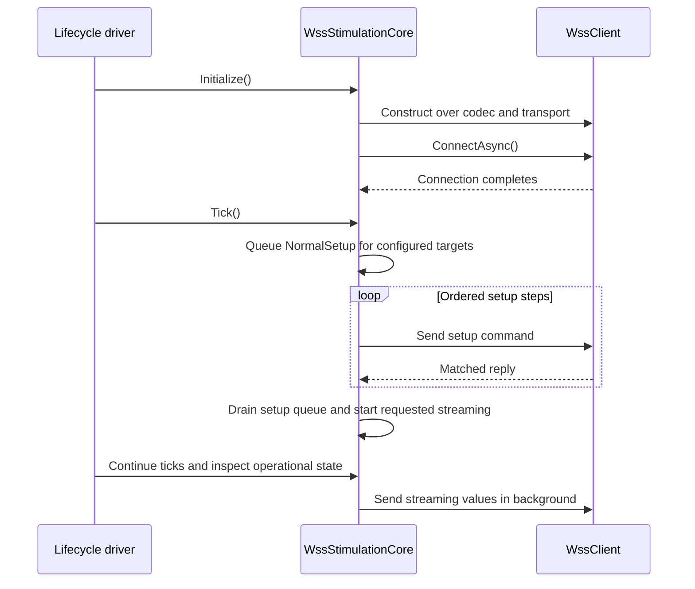
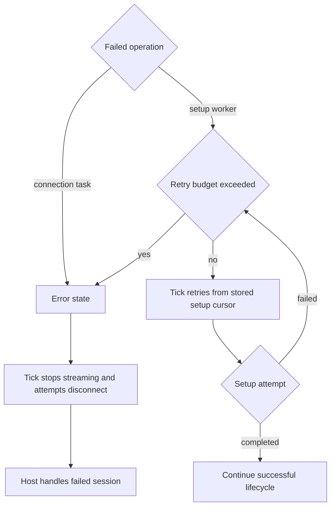
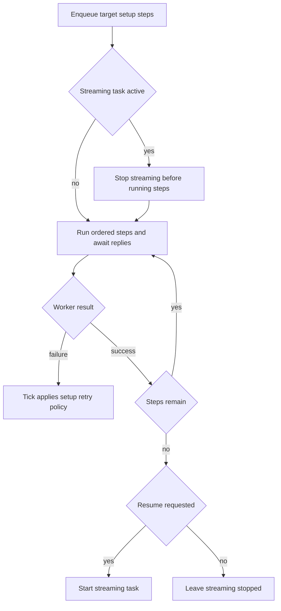

# Core Architecture (Transport, Codec, Core)

[Home](../index.md) | [Back to Concepts](../concepts.md)

Core coordinates connection, device setup, queued edits and streaming. Its protocol client uses a frame codec and a byte transport as separate collaborators. This guide explains those responsibilities and the lifecycle they support. See [Layering Guide](layering-guide.md) for application/integration composition and [Setup Order and Modification](setup-order-and-modification.md) for device-command dependencies.

## Control and byte flow

| Component | Responsibility |
| --- | --- |
| `WssStimulationCore` | Owns the transport lifetime, constructs the client, advances lifecycle state, schedules setup and maintains streaming values. |
| `WssClient` | Builds command payloads, calls the codec, sends through the transport, and matches replies to pending commands. |
| `WssFrameCodec` | Frames outgoing payloads and progressively deframes incoming chunks, including checksum validation. It does not own or connect the transport. |
| `ITransport` | Connects, disconnects, sends bytes and raises `BytesReceived` with incoming chunks. Chunks need not align with message boundaries. |

The caller invokes Core control/status methods. Core delegates protocol operations to the client. The client asks the codec to frame outgoing payloads, then sends the resulting bytes through the transport. Inbound chunks return to the client, which feeds them to the codec and correlates the resulting frames with waiting commands.

For direct Core/layer composition, the host supplies `Tick()`. An integration can own that loop instead: C# and Python controllers have background ticks, and Unity advances through its component lifecycle. Follow the integration's lifecycle contract instead of adding a second loop.

## Successful startup

`Initialize()` loads configuration, creates a client over the retained transport and begins connecting. Ticks observe connection completion and start `NormalSetup()`. For each target, that setup queues clear/query operations, channel schedules and contact/event configuration, synchronization and finally `StartStim`. The setup worker awaits command replies.

Initial setup requests streaming automatically. The worker can start the streaming task when its queue drains, while ticks advance the public lifecycle through `Ready`, `Started` and `Streaming`. `Ready()` can therefore be transient. Observe the operational predicate documented by the selected integration rather than waiting exclusively for `Ready()`.

The following sequence shows the successful path only. Client operations use the codec and transport shown above; neither failure cleanup nor host shutdown is an implied step after success.

Initialization includes device setup and start commands. A status-only host example still needs an explicit emulator/test transport to avoid device I/O. Runnable host examples belong in the [integration READMEs](repository-and-kit-links.md).

## Failures and retries

A faulted connection task moves Core into `Error`. A failed setup worker is observed by `Tick()`: Core retries through the existing per-target cursor while the configured retry budget permits, and enters `Error` when that budget is exceeded. This is not a fresh connection or a replay of the entire initial setup on every attempt.

In `Error`, ticks stop the streaming task and attempt to disconnect. That path does not perform final disposal or change the state to `Disconnected`. The host handles the failed session explicitly, using `Shutdown()` before a new initialization or `Dispose()` when the Core instance is finished.

Command timeouts and device error replies can fault a setup step. A passing setup result does not establish later radio availability or hardware behavior; the application still needs bounded waits and error handling at its integration boundary.

## Queued edits and conditional resume

Public setup operations can enqueue device work while the system is running. The scheduler records the target and steps, pauses an active streaming task, and allows the worker to await replies in order. If more steps arrive while setting up, later passes drain the remaining queue.

Resuming streaming is a separate decision from finishing the commands. A resumable edit requests restoration of an active stream; `StopStim` explicitly clears that request. Completion alone does not imply that streaming starts again.

For example, a waveform update during an active stream can pause the stream, perform its queued device edits and resume when the queue is empty. A stop request follows the same scheduling mechanism with resume disabled, so draining that stop batch leaves the stream stopped. Serialize lifecycle and setup operations in the host rather than treating concurrent edits as a safety guarantee.

`StartStim` from `Ready` queues a device start. During initial startup, `NormalSetup()` already includes that command. Streaming periodically sends cached channel values; it does not wait for a fresh application request for every packet. Setup commands that require replies and one-way streaming packets therefore have different response behavior.

## Device reset, shutdown and disposal

A device MCU reset is a protocol operation (`WssClient.Reset`), whereas host shutdown releases a running session. They are not interchangeable. An integration must deliberately expose and coordinate a reset if its application needs one; calling a low-level client operation directly does not automatically apply Core's scheduler policy.

| Operation | Effect | Reuse |
| --- | --- | --- |
| `StopStim` | Queues a device stop and disables automatic stream resume for that batch. | Keeps the session and transport. Later actions follow the lifecycle state. |
| Error handling in `Tick()` | Stops the streaming task and attempts disconnect. | Does not dispose the client/transport or reset Core to `Disconnected`. |
| `Shutdown()` | Stops streaming, attempts to zero outputs, attempts disconnect, disposes the client and clears session state. | Retains the transport and sets `Disconnected`, allowing another `Initialize()`. |
| `Dispose()` | Calls shutdown, then disposes the transport and marks Core disposed. | Terminal for this Core instance. A later `Initialize()` throws `ObjectDisposedException`. |

Zeroing and disconnect during cleanup are best-effort attempts. Cleanup is not a promise that the device acknowledged a stop, and forced process termination cannot run normal cleanup. Use the host integration's documented shutdown/disposal mechanism.

## Core capabilities and implementation map

`WssStimulationCore` implements lifecycle/control (`IStimulationCore`), basic waveform/event/config operations (`IBasicStimulation`) and advanced event programming (`IAdvancedEventProgrammer`). Basic Stimulation is a capability of this concrete Core, not an independently attached decorator. An integration or parameter/model layer decides which capabilities to forward. See the [layering guide](layering-guide.md) for those composition boundaries.

These paths are in the [Core repository](xref:repo.core). Internal helpers listed here explain implementation, not methods an application can call:

- `CoreModule/WssStimulationCore.cs`: `Initialize`, `Tick`, `Shutdown`, `Dispose`; private `NormalSetup`, `ScheduleSetupChangeAsync`, `SetupWorkerAsync` and `StepLogger`.
- `CoreModule/WssClient.cs`: command construction, framing calls, transport access and reply correlation.
- `CoreModule/WssFrameCodec.cs` and `CoreModule/Interfaces/IFrameCodec.cs`: framing and progressive deframing.
- `CoreModule/Interfaces/ITransport.cs`: byte transport contract. Implementations include `WSS.Transport.Serial/SerialPortTransport.cs` and `CoreModule/TestModeTransport.cs`.

Navigation:

- [Back to Home](../index.md)
- [Back to Concepts](../concepts.md)
- [Related: Layering Guide (Modules)](layering-guide.md)
- [Related: Setup Order and Modification](setup-order-and-modification.md)
