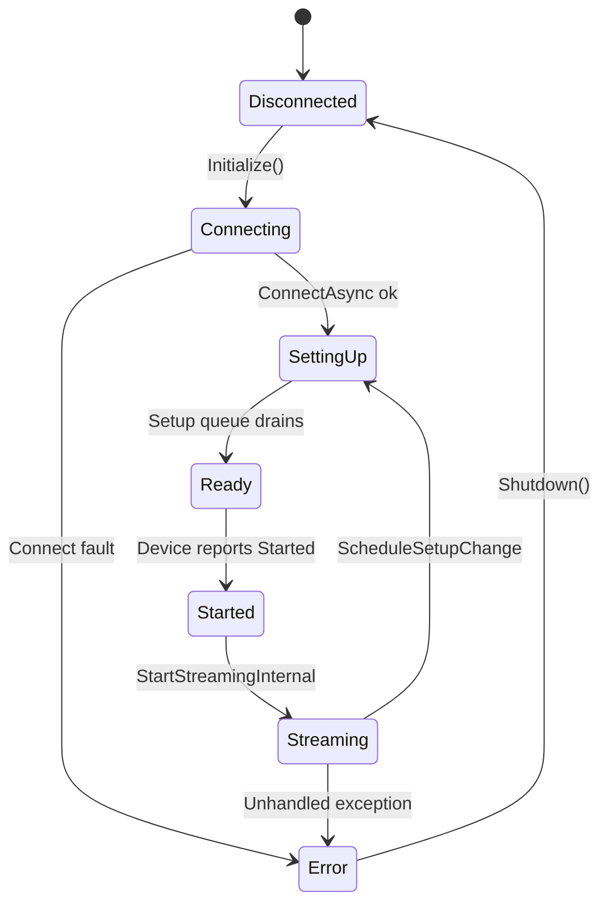
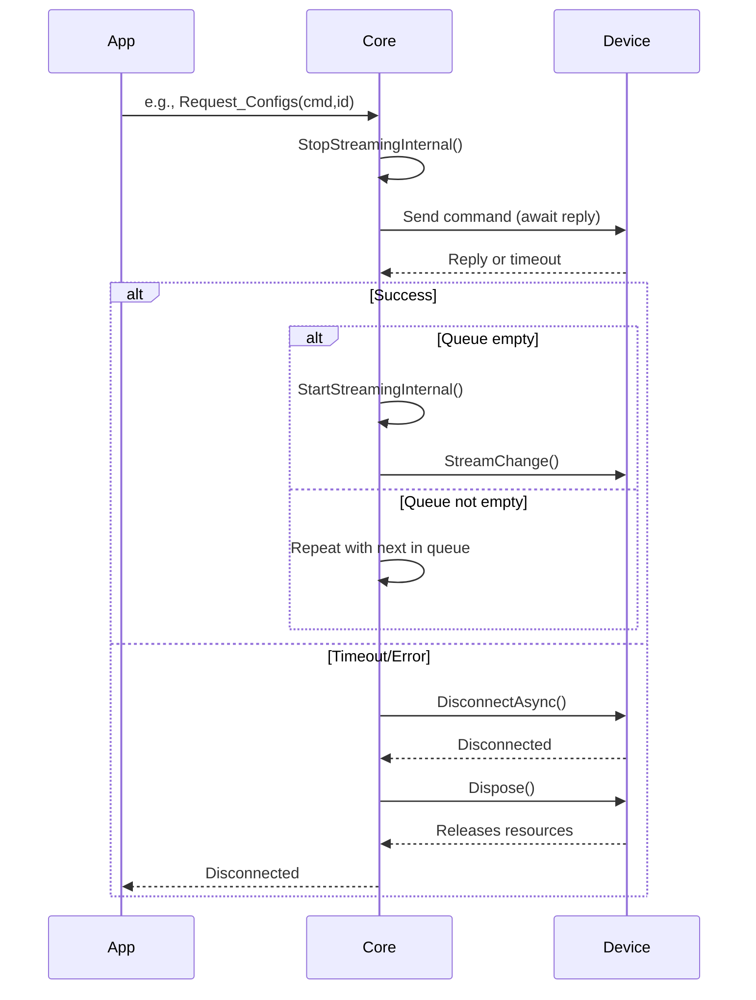

# Core Architecture (Transport, Codec, Core)

[Home](../index.md) | [Back to Concepts](../concepts.md)

This guide explains the stack beneath the core—how bytes move from transports to the frame codec to the core—and the lifecycle flows (initialize, setup, start/stop streaming, mid-stream edits with replies, reset/shutdown).

For a guide focused specifically on setup order, initial setup versus later setup replacement, and where setup changes can be made, see [Setup Order and Modification](setup-order-and-modification.md).

## Stack Summary
- Transport (`CoreModule/Interfaces/ITransport.cs`)
  - Serial: `WSS.Transport.Serial/SerialPortTransport.cs`; Test: `CoreModule/TestModeTransport.cs`
  - Surfaces `BytesReceived` chunks (no message boundary guarantee).
- Frame Codec (`CoreModule/Interfaces/IFrameCodec.cs` → `CoreModule/WssFrameCodec.cs`)
  - Frames/deframes bytes and validates messages.
- Core (`CoreModule/WssStimulationCore.cs`)
  - State machine: Disconnected → Connecting → SettingUp → Ready → Started → Streaming (→ Error)
  - Queues setup steps; non-blocking public calls schedule device edits.
  - Background streaming loop sends periodic packets when in `Streaming`.


The host owns ticking only when composing Core or layers directly. C# and Python controllers run their own update loops, while Unity advances through its component lifecycle. Do not add a second loop around a wrapper.

## Lifecycle: States and Transitions


## Startup and Shutdown Sequence
```mermaid
sequenceDiagram
  participant App
  participant Core
  participant Device
  App->>Core: Initialize()
  Core->>Device: ConnectAsync()
  App->>Core: Tick()
  Device-->>Core: Connected
  Core->>Core: Observes Connected -> NormalSetup()
  Core->>Device: Clear/ModuleQuery/Create/Config/Edit/Add/Sync/StartStim (queued)
  Device-->>Core: Replies per step
  Core->>Core: Queue drains; observe Ready or Started
  Device-->>Core: Started
  Core->>Core: Observes Started -> StartStreamingInternal()
  Core->>Device: StreamChange()
  Device-->>Core: Error
  Core->>Core: Observes Error -> StopStreamingInternal()
  Core->>Device: DisconnectAsync()
   Device-->>Core: Disconnected
  Core->>Device: Dispose()
   Device-->>Core: Releases resources
   Core-->>App: Disconnected
  App->>Core: Shutdown()
  Core->>Core: StopStreamingInternal()
  Core->>Device: DisconnectAsync()
   Device-->>Core: Disconnected
  Core->>Device: Dispose()
   Device-->>Core: Releases resources
   Core-->>App: Disconnected
```

Notes
- `NormalSetup()` seeds a full device configuration and ends with `StartStim(...)` for each target.
- `Tick()` advances the state machine; `StartStreamingInternal()` begins the background streaming loop.
- `Shutdown()` disconnects and disposes the client while retaining the transport for a later `Initialize()`. `Dispose()` also disposes the transport and makes the core terminal; a later `Initialize()` throws `ObjectDisposedException`.

## Mid‑Stream Setup (Commands Requiring Replies)


Behavior
- Public mutators (e.g., `StartStim`, `StopStim`, `UpdateIPD`, waveform edit/load/save/load) call `ScheduleSetupChangeAsync`.
- If currently `Streaming`, streaming pauses once for the batch, then resumes automatically when the queue drains.
- Steps await replies; `StepLogger` throws on device `Error:` or timeout.

## Start and Stop
- Start
  - From `Ready`, calling `StartStim(...)` schedules a start step; when the device reports started, state advances and streaming begins.
- Stop
  - Calling `StopStim(...)` schedules stop with `resumeStreaming: false`; if streaming, the core stops the streaming loop before running the queued stop. Draining that streaming-stop batch does not itself resume streaming. Later commands can request a new start/resume; serialize lifecycle and setup operations in the host.
  - To fully stop activity, follow with `Shutdown()` or avoid scheduling additional edits.

## Reset and Shutdown
- Reset (device MCU): use `WssClient.Reset(...)` as a scheduled setup step so the core pauses streaming and waits for the reply before resuming. Example:
```csharp
_ = ScheduleSetupChangeAsync(WssTarget.Wss1,
    () => StepLogger(_wss.Reset(WssTarget.Wss1), "Reset[Wss1]"));
```
- Shutdown
  - `Shutdown()` stops streaming, attempts `ZeroOutStim()`, disconnects, and disposes the client. It retains the transport. `Dispose()` owns final transport disposal.

## Edge Cases
- Scheduling edits while `SettingUp` appends to the queue; the runner performs additional passes until empty.
- Errors during setup set state to `Error`; `Tick()` then stops streaming and disconnects.
- Long-running streaming: periodic packets are sent per WSS at the configured cadence; unchanged parameters send minimal data.

## Optional Basic Stimulation Layer
- `IBasicStimulation` augments the core with waveform/event/config operations. In the current implementation, `WssStimulationCore` implements this interface and routes calls through `ScheduleSetupChangeAsync`, which:
  - Pauses streaming if active, enqueues setup steps that await device replies, and resumes streaming when the queue drains.
  - Queues mid-stream edits and waits for device replies. This describes scheduling behavior, not a hardware safety guarantee.


Navigation:

- [Back to Home](../index.md)
- [Back to Concepts](../concepts.md)
- [Related: Layering Guide (Modules)](layering-guide.md)
