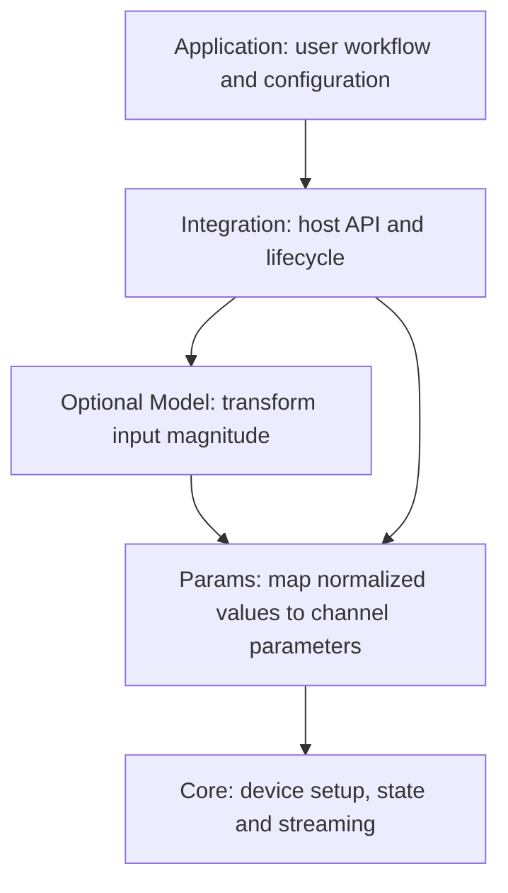

# Layering Guide (Modules)

[Home](../index.md) | [Back to Concepts](../concepts.md)

An application chooses what to do; an integration makes WSS usable in its host;
the shared layers turn those requests into device operations. Start with the
integration for your language or engine. Compose the shared layers yourself
when building a new integration or a specialized host.

## The Big Picture

Model applies configured P/PD processing to an input magnitude and passes the
result to Params. Applications that supply normalized values can use Params
directly. Lifecycle operations and direct analog commands are forwarded through
the layers without those transformations.

Core also works on its own. A custom host can call Core directly, or wrap it
with Params, or wrap Params with Model. Existing integrations supply their
composition and host-facing API. The [repository directory](repository-and-kit-links.md)
links to those setup instructions.

## Responsibilities and When to Use Them

| Part | Responsibility | Use it when |
| --- | --- | --- |
| Application | User interface, experiment workflow, configuration selection, state display and shutdown boundary. | Running a CLI, GUI, robotics workflow or experiment. |
| Integration | Adapt the shared stack to C#, Python, Unity or MATLAB; expose host-friendly methods and arrange lifecycle/update ownership. | Calling WSS from that host. Its README defines installation, update scheduling and cleanup. |
| Model (`ModelParamsLayer`) | Apply configured P/PD processing through `StimWithMode`, then pass the resulting normalized magnitude to Params. | Input magnitude should be transformed by the configured model. Direct `StimulateNormalized` calls bypass this model calculation. |
| Params (`StimParamsLayer`) | Map normalized input to per-channel pulse-width or amplitude settings using configured limits, defaults and interval; expose parameter access. | Applications should work with normalized values and reusable channel configuration. |
| Core (`WssStimulationCore`) | Coordinate connection, ordered device setup, queued edits, lifecycle state and background streaming. | Every shared-layer composition needs device orchestration; use Core directly when the host already supplies the higher-level parameter behavior. |

Params wraps an `IStimulationCore`; Model wraps an `IStimParamsCore`.
They add behavior and forward lifecycle calls to the same underlying Core.
Core delegates protocol operations to its client;
client, codec and transport wiring belongs to the
[Core architecture guide](core-architecture.md).

## One Request Through the Layers

Consider a simulated channel configured for pulse-width control, with
`minPW = 50` and `maxPW = 250`. These numbers illustrate the mapping; they
are not an experiment configuration or a recommendation for a device.

1. The application supplies a normalized value of `0.5` through its integration.
2. With `StimulateNormalized`, Params receives that value directly. With
   `StimWithMode`, Model first calculates a value from the selected P/PD model,
   then forwards it to Params. A P model with gain `1` and offset `0` leaves
   `0.5` unchanged.
3. Params bounds the normalized value to `0..1`. In this pulse-width example,
   it maps the positive value to `50 + (250 - 50) * 0.5 = 150`, rounds to an
   integer pulse width, and takes amplitude and interval from channel configuration.
4. Params calls Core's analog operation with those channel parameters. Core
   applies its device/protocol behavior and updates the stimulation stream.

In amplitude-control mode, Params varies amplitude and takes the configured
default pulse width instead. At Params' input, a normalized value at or below zero uses the
zero-output branch rather than the positive-value minimum. See the
[configuration reference](config-files-reference.md) for the corresponding
fields. Exact host method signatures and runnable examples belong to each
integration's README and API reference.

## Composition and Setup Order

Choose the configuration directory and transport before initializing the
integration. When composing layers directly, construct Core first, wrap it with
Params if needed, then wrap Params with Model if needed. Initialize the outer
object so initialization reaches the underlying stack.

Device setup order is a separate concern from object construction. Core connects,
queues the firmware-dependent setup steps, and advances the shared lifecycle.
Its normal setup includes a start request and can advance into
Started/Streaming; Ready can be transient. Follow the integration's documented
operational-state check and update ownership, and do not add another tick loop
around a controller that already owns one.

Use [Setup Order and Modification](setup-order-and-modification.md) for the
command sequence, initial setup versus later edits, and where to make setup
changes. Use [Core Architecture](core-architecture.md) for scheduling, streaming
and client/transport details. Keep device edits in Core's scheduling path rather
than sending a second stream of protocol commands from a layer.

## Optional Capability: Basic Stimulation

Core exposes waveform, event and board-configuration operations through the
optional `IBasicStimulation` interface. Params discovers the
capability on its underlying Core; Model forwards that discovery through Params.
Integration libraries expose the resulting capability using their host API.

The interface includes waveform/event edits, board configuration save/load/query,
and inter-phase-delay updates. Core schedules these operations through its setup
machinery. Supported operations depend on the selected firmware and device.
Consult the
[firmware compatibility matrix](firmware-compatibility-matrix.md) and API contract.

The capability can be used with Core alone, Core + Params, or Core + Params +
Model.

## Source References

These paths are in the [Core repository](xref:repo.core):

- Core and capability: `CoreModule/WssStimulationCore.cs`,
  `CoreModule/Interfaces/IBasicStimulation.cs`.
- Params: `CalibrationModule/StimParamsLayer.cs`,
  `StimParamsConfig.cs`, `StimParamsConfigController.cs`, `IStimParamsCore.cs`
  in the same directory.
- Model: `ModelModule/ModelParamsLayer.cs`, `ModelConfig.cs`,
  `ModelConfigController.cs`, `IModelParamsCore.cs` in the same directory.

Navigation:

- [Back to Home](../index.md)
- [Back to Concepts](../concepts.md)
- [Related: Setup Order and Modification](setup-order-and-modification.md)
- [Related: Core Architecture](core-architecture.md)
- [Repository setup guides](repository-and-kit-links.md)
